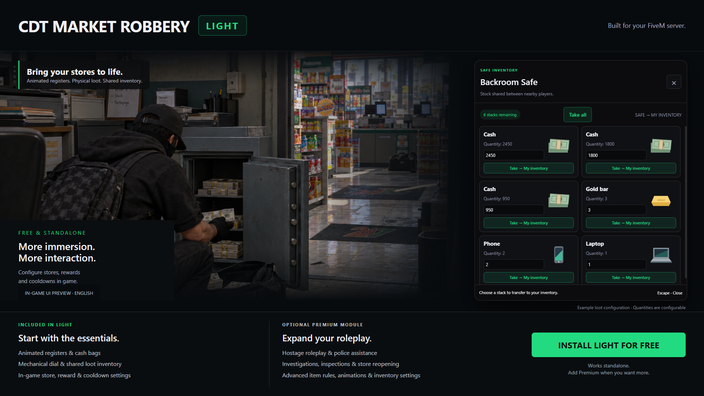
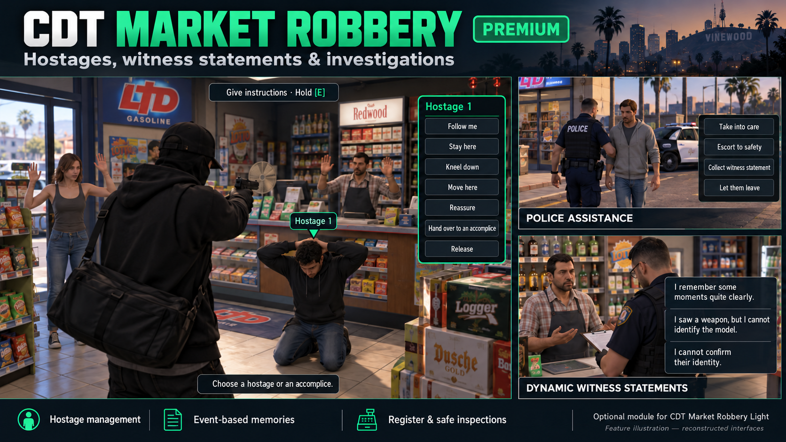

# CDT Market Robbery Light

**[Français](#fr) · [English](#en)**

Free convenience store robberies for FiveM · Braquages de supérettes gratuits pour FiveM.



<a id="fr"></a>

## Français

**CDT Market Robbery Light** est une ressource gratuite et autonome pour FiveM. Intimidez le commerçant, faites-lui vider les caisses, récupérez les sacs d'argent et ouvrez les coffres avec un mini-jeu de cadran mécanique.

### Fonctionnalités

- Commerçant animé, caisses et sacs d'argent récupérables.
- Coffres au cadran mécanique avec quatre niveaux de difficulté.
- Butin physique et inventaire partagé : prise par quantité ou « Tout prendre ».
- Configuration en jeu des supérettes, positions, récompenses, délais et alertes police.
- Réservation des lots et protections contre les doubles paiements.
- Interfaces et notifications en français et en anglais.

### Dépendances

Serveur FiveM avec **OneSync**, **ox_lib**, **oxmysql** et une connexion MySQL configurée. Framework **Qbox**, **QBCore** ou **ESX**.

Inventaires pris en charge : **Ox**, **QB**, **Quasar**, **Origen**, **Core**, **TGIANN**, **Jaksam** ou celui du framework. Les versions du framework et de l'inventaire doivent être compatibles entre elles et fournir les exports attendus par les adaptateurs. Vérifiez leur fonctionnement en jeu.

### Compatibilité des frameworks et bridges

Les intégrations ci-dessous sont présentes dans le code de la ressource. Aucun framework autonome supplémentaire n'est fourni.

| Framework | Ressource attendue | Fonctions prises en charge |
| --- | --- | --- |
| Qbox | qbx_core | Joueurs, métiers, service police, permissions et argent via les API Qbox. Un inventaire pris en charge est obligatoire. |
| QBCore | qb-core | Joueurs, métiers, service police, permissions, argent et inventaire du framework. |
| ESX | es_extended | Joueurs, métiers, groupes, comptes monétaires et inventaire du framework. cash correspond au compte money. |

Sélection dans **Administration → Framework et inventaire**. La détection automatique est disponible ; si plusieurs frameworks ou inventaires sont actifs, sélectionnez explicitement ceux utilisés. Ces bridges adaptent la Light à votre environnement ; ils ne rendent pas compatibles entre eux des frameworks et inventaires qui ne le sont pas.

#### Bridges d'inventaire inclus dans la Light

| Inventaire | Ressource attendue | Exports/API utilisés côté serveur |
| --- | --- | --- |
| Ox Inventory | ox_inventory | Search, CanCarryItem, AddItem, RemoveItem |
| QB Inventory | qb-inventory | GetItemCount, CanAddItem, AddItem, RemoveItem |
| Quasar Inventory | qs-inventory | GetItemTotalAmount, CanCarryItem, AddItem, RemoveItem |
| Origen Inventory | origen_inventory | getItemCount, canCarryItem, addItem, removeItem |
| Core Inventory | core_inventory | getItemCount, canCarry, addItem, removeItem |
| TGIANN Inventory | tgiann-inventory | GetItemCount, CanCarryItem, AddItem, RemoveItem |
| Jaksam Inventory | jaksam_inventory | getTotalItemAmount, canCarryItem, addItem, removeItem |
| Inventaire du framework | es_extended / qb-core | API xPlayer ESX ou Functions QBCore ; indisponible comme solution de repli sur Qbox. |

Le coffre utilise le stock partagé interne CDT. Les objets sont transférés vers l'inventaire sélectionné ; les récompenses de type argent passent par le framework. Aucun alias de ressource QB/Ox n'est nécessaire pour les autres adaptateurs.

Points particuliers : Core retire les objets requis depuis la première pile ; Jaksam ne compte pas le contenu des conteneurs imbriqués. Avec TGIANN, désactivez **createDropWhenPlayerFull** pour éviter un dépôt au sol si la capacité change pendant l'ajout. Les versions commerciales doivent fournir les exports indiqués ; aucun numéro de version universel n'est certifié.

#### Bridges de notifications inclus

| Système | Ressource attendue | Appel utilisé |
| --- | --- | --- |
| CDT | Intégré à la Light | Notifications, cartes de butin et alertes internes. |
| ox_lib Notify | ox_lib | lib.notify |
| okokNotify | okokNotify | Alert |
| Wasabi Notify | wasabi_notify | notify |
| Brutal Notify | brutal_notify | SendAlert |
| Mythic Notify | mythic_notify | DoCustomHudText |
| Quasar Interface | qs-interface | AddNotify |
| QBCore Notify | qb-core | Functions.Notify |
| ESX Notify | es_extended | ShowNotification |
| Notifications personnalisées | Votre ressource | Adaptateur à renseigner dans client/notifications_custom.lua. |

Choix dans **Administration → Interactions et notifications**. Démarrez le fournisseur sélectionné avant la Light. Si le fournisseur est indisponible ou refuse l'affichage, CDT prend le relais. Les cartes de butin avec images appartiennent à l'affichage CDT ; les fournisseurs externes reçoivent un résumé textuel. Les marqueurs police sur la carte restent gérés par CDT.

#### Limites Light / options Premium

- **Light** : interactions par touche, inventaires standards et tous les bridges de notifications ci-dessus, y compris les notifications personnalisées.
- **Premium** : réglages de target pour ox_target ou qb-target, ainsi que configuration d'un inventaire personnalisé par fichier ou exports dans l'administration.
- Les scripts de notifications ne remplacent pas un système de dispatch : cette distribution ne fournit pas de bridge dédié pour un dispatch externe.

### Installation

1. Téléchargez les fichiers du dépôt et placez-les dans **resources/[cdt]/cdt_marketrobbery_light**.
2. Conservez exactement le nom **cdt_marketrobbery_light** pour le dossier de la ressource.
3. Démarrez votre framework, votre inventaire et les dépendances avant la Light.
4. Ajoutez les lignes suivantes dans votre **server.cfg** :

```cfg
set cdt_language "fr"
ensure oxmysql
ensure ox_lib
# Votre framework et votre inventaire doivent être démarrés ici.
ensure cdt_marketrobbery_light
add_ace group.admin cdt.market.light.admin allow
```

La table SQL **cdt_marketrobbery_light_data** est créée automatiquement. Les réglages et l'état des scènes sont conservés en base. Ne démarrez pas l'ancienne ressource **cdt_marketrobbery** sur les mêmes magasins.

### Configuration et commandes

| Commande | Utilisation |
| --- | --- |
| /marketlightadmin | Ouvrir l'administration et configurer les magasins. |
| /marketlightreset &lt;identifiant&gt; | Réinitialiser une supérette. |
| /marketlightminigame | Tester le cadran sans récompense ; argument facultatif : easy, normal, hard ou expert. |

Ces commandes sont réservées aux administrateurs autorisés. Configurez les accès ACE ou les groupes administrateurs dans **config.lua**. Utilisez **set cdt_language "en"** pour démarrer en anglais ; la langue peut aussi être modifiée dans l'administration.

Le système de notifications CDT est inclus. D'autres fournisseurs sont sélectionnables dans l'administration. Si plusieurs inventaires sont démarrés, choisissez explicitement celui utilisé au lieu du mode automatique.

### Module Premium optionnel

**La Light fonctionne seule. Le module Premium n'est pas inclus dans ce dépôt.**

Le module séparé **cdt_marketrobbery_premium** ajoute :

- Gestion des otages, consignes, transferts et libération.
- Prise en charge policière et départ des civils libérés.
- Témoignages du commerçant et des otages, avec des souvenirs variables liés aux événements.
- Inspections des caisses et des coffres, puis réouverture du magasin.
- Conditions d'armes et d'objets, difficulté personnalisée et réglages avancés.

Placez son dossier à côté de la Light et démarrez-le avant elle :

```cfg
ensure cdt_marketrobbery_premium
ensure cdt_marketrobbery_light
```

Avec la Light **1.2.0** et le module Premium **1.1.0** ou ultérieurs, vous pouvez aussi démarrer le module puis utiliser **Détecter les modules → Activer le module maintenant** dans l'administration. Enregistrez vos modifications et terminez les scènes avant l'activation.

### Support et informations sur le module Premium

Besoin d'aide pour installer la Light, configurer votre serveur ou en savoir plus sur le module Premium ?

**[Rejoignez notre Discord pour le support et les informations sur le module Premium](https://discord.gg/yNkYVhNCQQ)**

### Documentation

- [Notes techniques détaillées en français](docs/TECHNICAL.fr.md).
- Documentation dédiée : **en cours de préparation**.
- Après installation, testez un braquage complet, un inventaire plein et une prise simultanée du butin à deux joueurs. Les animations et les mappings doivent être validés sur votre serveur.

---

<a id="en"></a>

## English

**CDT Market Robbery Light** is a free, standalone FiveM resource. Threaten the shopkeeper, make them empty the registers, collect cash bags and open safes through a mechanical dial minigame.

### Features

- Animated shopkeeper, registers and collectible cash bags.
- Mechanical safe dial with four difficulty levels.
- Physical loot and shared inventory: choose quantities or use “Take All”.
- In-game configuration for stores, positions, rewards, timers and police alerts.
- Loot reservations and protection against duplicate payouts.
- French and English interfaces and notifications.

### Dependencies

A FiveM server with **OneSync**, **ox_lib**, **oxmysql** and a configured MySQL connection. **Qbox**, **QBCore** or **ESX** framework.

Supported inventories: **Ox**, **QB**, **Quasar**, **Origen**, **Core**, **TGIANN**, **Jaksam** or the framework inventory. Your framework and inventory versions must be compatible and provide the exports expected by the adapters. Verify operation in game.

### Framework and bridge compatibility

The integrations below are implemented in the resource. No additional standalone framework is provided.

| Framework | Expected resource | Supported functions |
| --- | --- | --- |
| Qbox | qbx_core | Players, jobs, police duty, permissions and money through Qbox APIs. A supported inventory is required. |
| QBCore | qb-core | Players, jobs, police duty, permissions, money and framework inventory. |
| ESX | es_extended | Players, jobs, groups, money accounts and framework inventory. cash maps to the money account. |

Select them in **Administration → Framework and inventory**. Automatic detection is available; explicitly select your framework and inventory if multiple resources are active. These bridges connect Light to your environment; they do not make otherwise incompatible frameworks and inventories compatible with each other.

#### Inventory bridges included with Light

| Inventory | Expected resource | Server exports/APIs used |
| --- | --- | --- |
| Ox Inventory | ox_inventory | Search, CanCarryItem, AddItem, RemoveItem |
| QB Inventory | qb-inventory | GetItemCount, CanAddItem, AddItem, RemoveItem |
| Quasar Inventory | qs-inventory | GetItemTotalAmount, CanCarryItem, AddItem, RemoveItem |
| Origen Inventory | origen_inventory | getItemCount, canCarryItem, addItem, removeItem |
| Core Inventory | core_inventory | getItemCount, canCarry, addItem, removeItem |
| TGIANN Inventory | tgiann-inventory | GetItemCount, CanCarryItem, AddItem, RemoveItem |
| Jaksam Inventory | jaksam_inventory | getTotalItemAmount, canCarryItem, addItem, removeItem |
| Framework inventory | es_extended / qb-core | ESX xPlayer or QBCore Functions APIs; not available as a Qbox fallback. |

Safes use CDT's internal shared stock. Items are transferred to the selected inventory; money rewards use the framework. No QB/Ox resource aliases are required for the other adapters.

Specific behavior: Core removes required items from the first stack; Jaksam excludes nested container contents. With TGIANN, disable **createDropWhenPlayerFull** to prevent ground drops if capacity changes during an addition. Commercial versions must expose the listed exports; no universal version number is certified.

#### Included notification bridges

| System | Expected resource | API call |
| --- | --- | --- |
| CDT | Built into Light | Internal notifications, loot cards and alerts. |
| ox_lib Notify | ox_lib | lib.notify |
| okokNotify | okokNotify | Alert |
| Wasabi Notify | wasabi_notify | notify |
| Brutal Notify | brutal_notify | SendAlert |
| Mythic Notify | mythic_notify | DoCustomHudText |
| Quasar Interface | qs-interface | AddNotify |
| QBCore Notify | qb-core | Functions.Notify |
| ESX Notify | es_extended | ShowNotification |
| Custom notifications | Your resource | Implement the adapter in client/notifications_custom.lua. |

Select a provider in **Administration → Interactions and notifications** and start it before Light. CDT takes over if the provider is unavailable or rejects the notification. Loot cards with images use CDT's own display; external providers receive a text summary. Police map markers remain managed by CDT.

#### Light scope / Premium options

- **Light**: key interactions, standard inventories and all notification bridges listed above, including custom notifications.
- **Premium**: target settings for ox_target or qb-target, plus custom inventory configuration through a file or exports in administration.
- Notification scripts do not replace a dispatch system: this distribution does not include a dedicated external dispatch bridge.

### Installation

1. Download this repository's files and place them in **resources/[cdt]/cdt_marketrobbery_light**.
2. Keep the resource folder name exactly **cdt_marketrobbery_light**.
3. Start your framework, inventory and dependencies before Light.
4. Add the following lines to **server.cfg**:

```cfg
set cdt_language "en"
ensure oxmysql
ensure ox_lib
# Your framework and inventory must be started here.
ensure cdt_marketrobbery_light
add_ace group.admin cdt.market.light.admin allow
```

The **cdt_marketrobbery_light_data** SQL table is created automatically. Settings and scene state are stored in the database. Do not run the older **cdt_marketrobbery** resource on the same stores.

### Configuration and commands

| Command | Purpose |
| --- | --- |
| /marketlightadmin | Open administration and configure stores. |
| /marketlightreset &lt;id&gt; | Reset a store. |
| /marketlightminigame | Test the safe dial without rewards; optional argument: easy, normal, hard or expert. |

These commands require administrator access. Configure ACE permissions or administrator groups in **config.lua**. Use **set cdt_language "fr"** to start in French; the language can also be changed in administration.

CDT notifications are included. Other providers can be selected in administration. If multiple inventories are running, explicitly select the one you use instead of automatic detection.

### Optional Premium module

**Light works on its own. The Premium module is not included in this repository.**

The separate **cdt_marketrobbery_premium** module adds:

- Hostage management, orders, handovers and release.
- Police assistance and departure of released civilians.
- Shopkeeper and hostage statements, with variable memories based on events.
- Register and safe inspections, followed by store reopening.
- Weapon and item requirements, custom difficulty and advanced settings.

Place its folder next to Light and start it first:

```cfg
ensure cdt_marketrobbery_premium
ensure cdt_marketrobbery_light
```

With Light **1.2.0** and Premium **1.1.0** or newer, you can also start the module and use **Detect modules → Activate module now** in administration. Save your changes and finish active scenes before activation.

### Support and Premium module information

Need help installing Light, configuring your server or learning more about the Premium module?

**[Join our Discord for support and Premium module information](https://discord.gg/yNkYVhNCQQ)**

### Documentation

- [Detailed technical notes in French](docs/TECHNICAL.fr.md).
- Dedicated documentation: **coming soon**.
- After installation, test a full robbery, a full inventory and two players collecting loot simultaneously. Animations and map compatibility must be checked on your server.

---

## Premium preview / Aperçu Premium



*Feature illustration with reconstructed interfaces, not an in-game screenshot. / Illustration des fonctionnalités avec interfaces reconstituées, pas une capture prise en jeu.*

**[GitHub — CDT Market Robbery Light](https://github.com/Chris29380/cdt_marketrobbery_light)**
